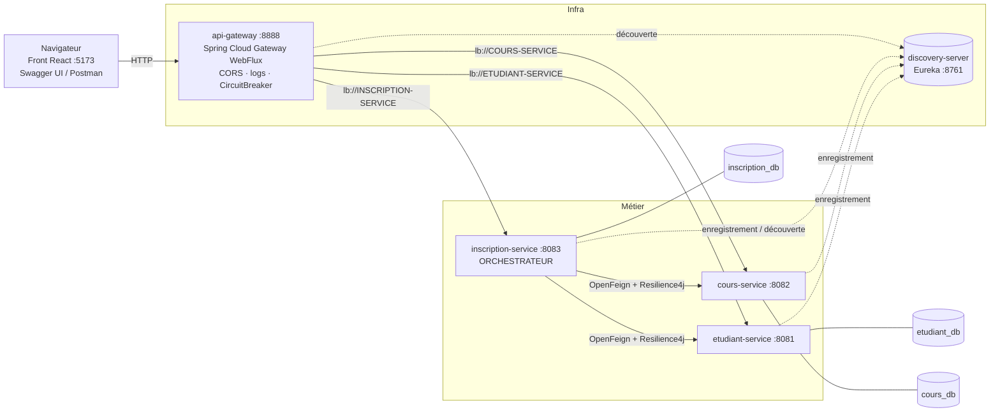

# Scolarité universitaire : architecture microservices

Mini-projet JEE2 (5ème GL) : gestion de la **scolarité** d'une école d'ingénieurs, découpée en
microservices **Spring Boot 3.4 / Spring Cloud 2024.0**.

- **Étudiants** : référentiel des étudiants (matricule, filière, niveau…).
- **Catalogue** : unités d'enseignement (**modules**, avec coefficient et crédits ECTS) et leurs **cours / TD / TP**.
- **Inscriptions pédagogiques** : un étudiant s'inscrit à un cours pour une année universitaire, reçoit une note ;
  l'orchestrateur produit le **relevé de notes** avec **moyenne pondérée**.

Points démontrables : annuaire **Eureka**, appels via l'**API Gateway** (`lb://`), agrégation **OpenFeign** dans des
champs **`@Transient`**, **tolérance aux pannes** (Resilience4j : Circuit Breaker, TimeLimiter, Retry, Fallback, cache de
secours), **Swagger UI** sur chaque service et agrégé sur la Gateway, et un **front-end React** (bonus).

---

## 1. Architecture



| Module | Rôle | Port | Base de données | Nom Eureka |
|---|---|---|---|---|
| `discovery-server` | Annuaire Eureka | **8761** | – | – |
| `api-gateway` | Point d'entrée unique (WebFlux), CORS, Swagger agrégé, fallback | **8888** | – | `API-GATEWAY` |
| `etudiant-service` | CRUD / recherche / pagination des étudiants | **8081** | `etudiant_db` | `ETUDIANT-SERVICE` |
| `cours-service` | Modules (UE) **1-N** Cours | **8082** | `cours_db` | `COURS-SERVICE` |
| `inscription-service` | **Orchestrateur** : inscriptions, notes, relevés (Feign) | **8083** | `inscription_db` | `INSCRIPTION-SERVICE` |
| `frontend` (bonus) | React 19 + Vite + Bootstrap, ne parle qu'à la Gateway | **5173** | – | – |

### Pourquoi ce découpage ?

- **Un microservice = un contexte métier (bounded context) et une équipe possible.** Le référentiel étudiants
  (administration), le catalogue (département pédagogique) et les inscriptions/notes (scolarité) évoluent à des rythmes
  différents et ont des règles propres.
- **Une base par service** : chaque service est le seul propriétaire de ses données. `inscription_db` ne stocke que des
  **identifiants** (`etudiantId`, `coursId`) ; les données complètes sont récupérées à la demande via Feign. Pas de
  jointure inter-bases, pas de couplage par le schéma, et chaque service peut changer de SGBD ou être redéployé seul.
- **Montée en charge ciblée** : en période d'inscriptions, seul `inscription-service` doit être répliqué
  (Eureka + LoadBalancer répartissent automatiquement la charge entre les instances).
- **Isolation des pannes** : si le référentiel étudiants tombe, les inscriptions restent consultables (mode dégradé).

---

## 2. Stack technique

| Élément | Version |
|---|---|
| Java | 17 |
| Spring Boot | **3.4.13** (POM parent) |
| Spring Cloud | **2024.0.3** (BOM importé dans le POM parent) |
| springdoc-openapi | **2.8.17** (`webmvc-ui` sur les services, `webflux-ui` sur la Gateway) |
| Resilience4j | 2.2.0 (via `spring-cloud-starter-circuitbreaker-resilience4j`) |
| Bases | H2 fichier (défaut) / MySQL 8.4 (profil `mysql`, Docker) |
| Front-end | React 19, React Router 7, Bootstrap 5.3, Vite 8 |

Le **POM parent unique** (`packaging pom`) hérite de `spring-boot-starter-parent`, importe le BOM
`spring-cloud-dependencies`, centralise les versions dans `<properties>` et déclare les 5 modules. Les modules enfants ne
précisent **aucune version** de dépendance.

Chaque service suit la même organisation en couches :
`entities` · `dto` · `mappers` · `repositories` · `services` (interface + impl) · `web` · `exceptions` · `config`
(+ `clients` et `model` dans l'orchestrateur).

---

## 3. Prérequis

- **JDK 17+** et **Maven 3.9+** dans le `PATH`
- **Node.js 20+** (uniquement pour le front-end)
- `curl` (présent sur Windows 10/11, Linux, macOS)
- *(optionnel)* Docker Desktop pour le profil MySQL

> ⚠️ **Conseil pour la soutenance (Windows) :** sous Windows, `mvn clean` échoue si un autre programme garde un
> dossier `target/` ouvert : synchronisation **OneDrive/Dropbox**, ou l'extension **Java de VS Code** (serveur de langage
> `redhat.java`) quand le projet est ouvert dans l'éditeur. Les scripts relancent alors automatiquement un
> `mvn package` sans `clean`. Pour éviter le problème, copiez le projet hors de OneDrive (ex. `C:\dev\`) ou fermez
> VS Code avant un `mvn clean install`.
>
> Les fenêtres réduites ouvertes par `start-all.bat` **sont** les services : ne les fermez pas et n'y tapez pas
> `Ctrl+C` (utilisez `stop-service.bat` / `stop-all.bat`).

---

## 4. Démarrage

### 4.1 Méthode recommandée : scripts (profil H2, aucune installation)

| | Windows | Linux / macOS / Git Bash |
|---|---|---|
| Build + démarrage complet | `start-all.bat` | `./start-all.sh` |
| Démarrage **sans recompiler** (jour J) | `start-all.bat --no-build` | `./start-all.sh --no-build` |
| Tout arrêter | `stop-all.bat` | `./stop-all.sh` |
| **Simuler une panne** | `stop-service.bat etudiant` | `./stop-service.sh etudiant` |

Ordre de démarrage : build Maven (+ build du front) → `discovery-server` → 15 s → `etudiant`, `cours`, `inscription`
(attente de leur `/actuator/health`) → `api-gateway` → `frontend`. Les logs sont écrits dans `logs/`.

> **Le jour de la soutenance :** lancez `start-all` (avec build) **avant** de passer, puis vérifiez le tableau de bord
> du front. En cas de redémarrage, `--no-build` démarre tout en ~40 s.

Les données de démonstration sont insérées automatiquement au premier démarrage (tables vides uniquement) :
10 étudiants, 5 modules, 10 cours et 15 inscriptions, avec des identifiants cohérents entre les services.
Pour **réinitialiser** les données : arrêter les services et supprimer le dossier `data/`.

### 4.2 Profil MySQL (Docker)

```bash
docker compose up -d                       # MySQL 8.4 (3306) + phpMyAdmin (http://localhost:8090)
SPRING_PROFILE=mysql ./start-all.sh        # Linux / macOS / Git Bash
set SPRING_PROFILE=mysql && start-all.bat  # Windows (cmd)
```

Les trois bases `etudiant_db`, `cours_db` et `inscription_db` sont créées automatiquement (script d'init +
`createDatabaseIfNotExist=true`). Identifiants : `root` / `root` (surchargeables via `MYSQL_HOST`, `MYSQL_USER`,
`MYSQL_PASSWORD`).

### 4.3 Démarrage manuel (IDE ou terminal)

```bash
mvn clean install                                   # compile + 43 tests unitaires
java -jar discovery-server/target/discovery-server-1.0.0.jar
java -jar etudiant-service/target/etudiant-service-1.0.0.jar      # --spring.profiles.active=mysql si besoin
java -jar cours-service/target/cours-service-1.0.0.jar
java -jar inscription-service/target/inscription-service-1.0.0.jar
java -jar api-gateway/target/api-gateway-1.0.0.jar
cd frontend && npm install && npm run dev
```

### 4.4 Dans IntelliJ IDEA

1. `File > Open` → sélectionner le dossier `scolarite-microservices` (le `pom.xml` parent est détecté, les 5 modules sont importés).
2. En haut à droite, la liste des configurations contient déjà (dossier `.run/`) :
   `1 - discovery-server`, `2 - etudiant-service`, `3 - cours-service`, `4 - inscription-service`, `5 - api-gateway`
   et **`0 - Tout demarrer`** (lance les 5 d'un coup ; les services s'enregistrent dans Eureka dès qu'il est prêt, ~10 s).
   Pour une démo propre : lancer `1 - discovery-server`, attendre ~10 s, puis `0 - Tout demarrer` (ou les autres un par un).
3. Le front se lance à part : `cd frontend && npm run dev`.
4. Ouvrir `docs/requests.http` : cliquer sur ▶ à côté d'une requête pour l'envoyer (client HTTP intégré à IntelliJ).

Pour le profil MySQL : `Run > Edit Configurations` → champ *Program arguments* : `--spring.profiles.active=mysql`.

---

## 5. URLs utiles

| Quoi | URL |
|---|---|
| Tableau de bord **Eureka** | http://localhost:8761 |
| Registre Eureka (XML/JSON) | http://localhost:8761/eureka/apps |
| **Front-end** | http://localhost:5173 |
| **Swagger agrégé** (sélecteur des 3 APIs) | http://localhost:8888/swagger-ui.html |
| Swagger étudiants / cours / inscriptions | http://localhost:8081/swagger-ui.html · http://localhost:8082/swagger-ui.html · http://localhost:8083/swagger-ui.html |
| Inscription enrichie via la Gateway | http://localhost:8888/api/inscriptions/1 |
| Relevé de notes | http://localhost:8888/api/inscriptions/etudiant/1/releve |
| Routage dynamique (discovery locator) | http://localhost:8888/etudiant-service/api/etudiants |
| Routes de la Gateway | http://localhost:8888/actuator/gateway/routes |
| **État des disjoncteurs** | http://localhost:8083/actuator/circuitbreakers |
| Événements des disjoncteurs | http://localhost:8083/actuator/circuitbreakerevents |
| Santé de l'orchestrateur | http://localhost:8083/actuator/health |
| Console H2 (profil h2) | http://localhost:8081/h2-console (8082, 8083) - JDBC `jdbc:h2:file:./data/etudiant_db;AUTO_SERVER=TRUE`, utilisateur `sa`, mot de passe vide |
| phpMyAdmin (profil mysql) | http://localhost:8090 |

Requêtes prêtes à l'emploi : [`docs/requests.http`](docs/requests.http) (VS Code REST Client / IntelliJ) et
[`docs/scolarite.postman_collection.json`](docs/scolarite.postman_collection.json) (Postman), toutes **via la Gateway**.

---

## 6. API (résumé)

**etudiant-service**: `/api/etudiants`
`GET /?page=0&size=20&sort=nom,asc` · `GET /{id}` · `GET /matricule/{matricule}` · `GET /search?nom=&filiere=&niveau=` ·
`GET /exists/{id}` · `POST /` · `PUT /{id}` · `DELETE /{id}`

**cours-service**: `/api/modules` (CRUD + `GET /{id}/cours`) et `/api/cours` (CRUD + `GET /module/{moduleId}` ·
`GET /search?titre=&enseignant=` · `GET /{id}/capacite`). Les cours embarquent un **résumé** de leur module (DTO), d'où
l'absence de boucle JSON Module ↔ Cours.

**inscription-service** (orchestrateur): `/api/inscriptions`
`GET /` · `GET /{id}` · `GET /etudiant/{id}` · `GET /etudiant/{id}/releve?annee=` · `GET /cours/{id}` ·
`POST /` · `PUT /{id}/statut` · `PUT /{id}/note` · `DELETE /{id}`

Règles de création : l'étudiant et le cours doivent exister (**404**), pas de doublon étudiant/cours/année (**409**),
capacité du cours non atteinte (**409** ; le cours `BIGD-TP` (id 6) est volontairement **complet**), et si un service
partenaire est hors ligne : **503** (on refuse d'inscrire « à l'aveugle »).

Toutes les erreurs ont le même format :
`{"timestamp", "status", "error", "message", "path"}` (+ `details` pour les erreurs de validation).

---

## 7. Tolérance aux pannes (résumé)

| Mécanisme | Où | Réglage |
|---|---|---|
| Circuit Breaker | Feign → `ETUDIANT-SERVICE`, `COURS-SERVICE` | fenêtre 5 appels, seuil 50 %, OPEN 10 s, 2 appels en HALF_OPEN |
| TimeLimiter | idem | 4 s |
| Timeouts Feign | idem | connexion 2 s, lecture 3 s |
| Retry | Feign (lectures GET) | 3 tentatives, backoff 200 ms ×1,5 (max 1 s) |
| Fallback + **cache de secours** | `FallbackFactory` | dernière valeur connue, sinon objet « INDISPONIBLE » |
| Création (POST) | orchestrateur | **503** explicite si un partenaire est indisponible |
| Circuit Breaker Gateway | chaque route `/api/**` | JSON 503 propre via `/fallback/{service}` |

En cas de panne d'`etudiant-service`, `GET /api/inscriptions/1` répond toujours **200** :

```json
{
  "id": 1, "note": 16.5, "statut": "VALIDEE",
  "etudiant": { "id": 1, "nom": "Ben Salah", "prenom": "Amine", "sourceDonnees": "CACHE_SECOURS" },
  "cours": { "code": "JEE2-C", "titre": "Microservices avec Spring Cloud" },
  "serviceStatus": { "ETUDIANT-SERVICE": "CACHE_SECOURS", "COURS-SERVICE": "UP" },
  "warnings": [ "ETUDIANT-SERVICE indisponible : données étudiant issues du cache de secours" ]
}
```

Détails, théorie et scénario pas à pas : **[docs/RESILIENCE.md](docs/RESILIENCE.md)**.
Script de soutenance minuté et questions probables : **[docs/DEMO.md](docs/DEMO.md)**.

---

## 8. Tests

```bash
mvn clean install        # à la racine : compile les 5 modules et exécute les 43 tests
```

- `EtudiantServiceImplTest`, `CoursServiceImplTest` : règles métier (doublons, introuvable, rattachement au module).
- `InscriptionServiceImplTest` : cas nominal, étudiant introuvable, capacité atteinte, doublon, **fallback Feign**
  (503 en création, réponse dégradée en lecture), moyenne pondérée, transitions interdites.
- `FallbackFactoryTest` : panne réseau → cache / objet INDISPONIBLE, circuit ouvert, 404 ≠ panne.
- `@WebMvcTest` pour chaque contrôleur principal : codes HTTP, format d'erreur uniforme, validation.

---

## 9. Arborescence

```
scolarite-microservices/
├── pom.xml                      POM parent (BOM Spring Cloud, versions centralisées)
├── discovery-server/            Eureka
├── api-gateway/                 Gateway WebFlux (routes, CORS, Swagger agrégé, fallback, logs)
├── etudiant-service/            tn.eps.scolarite.etudiant
├── cours-service/               tn.eps.scolarite.cours
├── inscription-service/         tn.eps.scolarite.inscription (clients Feign, fallbacks, cache)
├── frontend/                    React + Vite
├── docs/                        RESILIENCE.md, DEMO.md, requests.http, collection Postman
├── docker-compose.yml           MySQL + phpMyAdmin
├── start-all.(sh|bat)  stop-all.(sh|bat)  stop-service.(sh|bat)
└── logs/  data/                 (générés à l'exécution)
```
