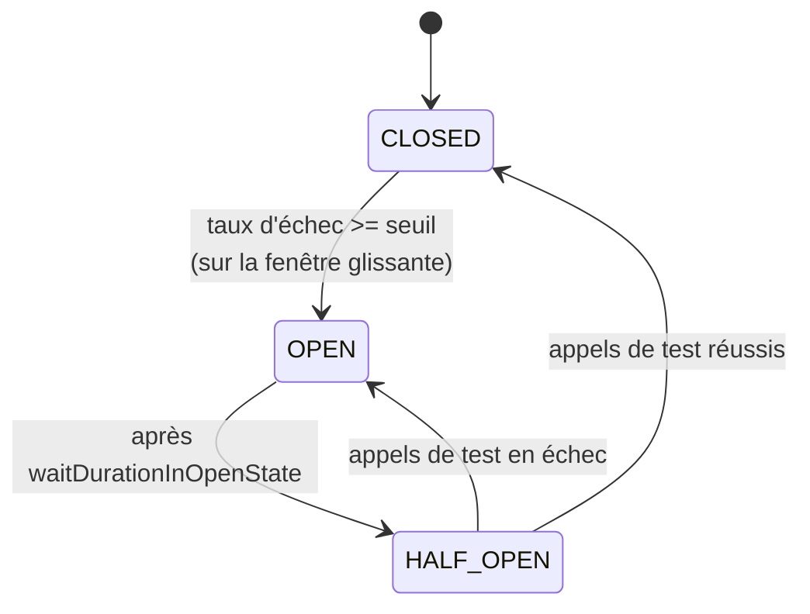
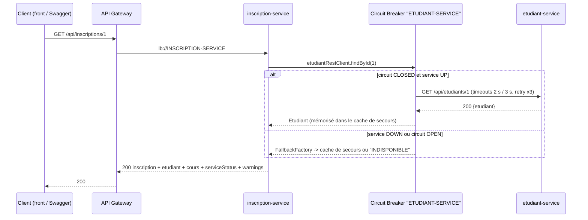

# Tolérance aux pannes dans une architecture microservices

*Travail de recherche : concepts, choix technologiques et mise en œuvre dans le projet « Scolarité universitaire ».*

---

## 1. Le problème : la panne en cascade

Dans un monolithe, un appel de méthode ne « tombe » pas en panne réseau. Dans une architecture microservices, chaque
appel inter-services traverse le réseau et peut échouer : service arrêté, redémarrage, saturation, lenteur de la base,
coupure réseau…

Sans protection, une panne se **propage** :

1. `etudiant-service` devient lent (ou ne répond plus) ;
2. chaque requête de `inscription-service` vers lui bloque un thread Tomcat en attendant la réponse ;
3. le pool de threads d'`inscription-service` s'épuise : il ne répond plus non plus, **même pour les requêtes qui
   n'ont pas besoin des étudiants** ;
4. la Gateway, puis le front, sont à leur tour bloqués : **une panne locale devient une panne globale**.

La **tolérance aux pannes** (*resilience*) regroupe les patterns qui limitent ce phénomène : échouer **vite**, échouer
**proprement**, et **continuer à rendre un service partiel** (dégradation gracieuse).

---

## 2. Les patterns de résilience

### 2.1 Timeout et TimeLimiter

Ne jamais attendre indéfiniment. Un **timeout** borne la durée d'un appel :

- **connect timeout** : délai pour établir la connexion TCP ;
- **read timeout** : délai d'attente de la réponse une fois connecté ;
- **TimeLimiter** (Resilience4j) : délai **global** d'un appel (retries compris), exécuté dans un `Future` et annulé si
  le délai est dépassé (`TimeoutException`).

> Un appel qui échoue en 3 s vaut mieux qu'un appel qui bloque un thread pendant 60 s.

### 2.2 Retry (nouvelle tentative)

Beaucoup d'erreurs sont **transitoires** (redémarrage, perte d'un paquet). Le Retry rejoue l'appel quelques fois, avec
un **backoff** (attente croissante, souvent exponentielle) pour ne pas surcharger un service qui redémarre.

Précautions :
- ne rejouer que les opérations **idempotentes** (lectures GET) : rejouer un POST peut créer des doublons ;
- nombre de tentatives **limité** (2 à 3) ; combiné au Circuit Breaker, on ne réessaie plus quand le circuit est ouvert.

### 2.3 Circuit Breaker (disjoncteur)

Inspiré du disjoncteur électrique : quand un service partenaire échoue trop souvent, on **cesse de l'appeler** pendant
un temps et on répond immédiatement avec un fallback. Cela protège l'appelant (pas de threads bloqués) **et** l'appelé
(on le laisse redémarrer sans le bombarder).



| État | Comportement |
|---|---|
| **CLOSED** (fermé) | Fonctionnement normal : les appels passent. Chaque succès/échec est enregistré dans une **fenêtre glissante** (les *N* derniers appels, ou les *N* dernières secondes). |
| **OPEN** (ouvert) | Le taux d'échec a dépassé le seuil : les appels **ne partent plus** (`CallNotPermittedException`) et le fallback est exécuté **immédiatement**. |
| **HALF_OPEN** (semi-ouvert) | Après un délai, un petit nombre d'appels **de test** est autorisé. S'ils réussissent → CLOSED ; sinon → OPEN à nouveau. |

Paramètres principaux : taille et type de fenêtre (`COUNT_BASED` / `TIME_BASED`), nombre minimal d'appels avant
évaluation, seuil de taux d'échec (et de lenteur : *slow call rate*), durée de l'état OPEN, nombre d'appels autorisés en
HALF_OPEN, exceptions à ignorer (une erreur métier n'est pas une panne).

### 2.4 Fallback (repli)

Réponse de secours renvoyée quand l'appel échoue ou que le circuit est ouvert : valeur par défaut, objet « dégradé »,
donnée en cache, message explicite… Le fallback doit être **rapide** et **ne pas dépendre** du service en panne.

### 2.5 Cache de secours

Variante du fallback : on mémorise la **dernière réponse valide** de chaque ressource et on la ressert pendant la panne,
en signalant qu'elle peut être périmée. Très efficace pour des données qui changent peu (nom d'un étudiant, intitulé
d'un cours). Limites : la donnée peut être obsolète, et le cache est vide pour une ressource jamais consultée.

### 2.6 Bulkhead (cloison étanche)

Comme les compartiments d'un navire : on **isole les ressources** (threads, connexions) allouées à chaque dépendance.
Si les appels vers le service A saturent leur compartiment (ex. 10 appels concurrents max), les appels vers B ne sont
pas impactés. Deux variantes : sémaphore (limite de concurrence) ou pool de threads dédié.

### 2.7 Rate Limiter (limitation de débit)

Limite le nombre d'appels autorisés par période (ex. 100 requêtes / seconde). Il protège un service contre la
surcharge (pics, clients abusifs). On l'applique typiquement **côté serveur** ou sur la Gateway
(`RequestRateLimiter` avec Redis dans Spring Cloud Gateway), tandis que le Circuit Breaker protège **côté client**.

### 2.8 Dégradation gracieuse

Principe d'ensemble : **mieux vaut une réponse partielle qu'une erreur**. Le système continue à fournir les
fonctionnalités qui ne dépendent pas du composant en panne, et **informe** l'utilisateur de ce qui est dégradé.
À l'inverse, pour une opération qui **exige** une donnée fiable (ex. vérifier une capacité avant d'inscrire), il vaut
mieux **refuser explicitement** (HTTP 503) que de prendre une décision à l'aveugle.

---

## 3. Pourquoi Resilience4j plutôt que Hystrix ?

| | **Netflix Hystrix** | **Resilience4j** |
|---|---|---|
| Statut | En **mode maintenance** depuis fin 2018 (dernière version 1.5.18), plus de nouvelles fonctionnalités | Projet actif (v2.x, Java 17+) |
| Spring Cloud | Retiré de Spring Cloud à partir de **2020.0 (Ilford)** | Implémentation de référence de **Spring Cloud CircuitBreaker** |
| Conception | Monolithique, isolation par pools de threads par défaut, dépend d'Archaius / RxJava 1 | **Modulaire** (circuitbreaker, retry, timelimiter, bulkhead, ratelimiter, cache… séparés), léger, API fonctionnelle (décorateurs) |
| Configuration | Annotations `@HystrixCommand` | YAML Spring Boot, annotations (`@CircuitBreaker`, `@Retry`…) ou décorateurs programmatiques |
| Supervision | Hystrix Dashboard / Turbine (abandonnés) | Endpoints **Actuator** (`/actuator/circuitbreakers`, `/circuitbreakerevents`, health) + métriques **Micrometer** (Prometheus/Grafana) |
| Compatibilité | Pas de support Spring Boot 3 / Jakarta EE | Support natif Spring Boot 3, WebFlux (Reactor) |

Netflix a lui-même recommandé Resilience4j pour les nouveaux projets. Spring Cloud a introduit l'abstraction
**Spring Cloud CircuitBreaker** : le code (et OpenFeign) dépend de l'abstraction, Resilience4j n'est que
l'implémentation branchée.

---

## 4. Mise en œuvre dans le projet

### 4.1 Vue d'ensemble



Deux niveaux de protection :

1. **Orchestrateur → partenaires** (OpenFeign + Resilience4j) : c'est le cœur de la démonstration ;
2. **Gateway → services** (filtre `CircuitBreaker` réactif) : si un service appelé *directement* via la Gateway est
   hors ligne, le client reçoit un JSON 503 propre au lieu d'une erreur 500 brute.

### 4.2 Dépendances

```xml
<!-- inscription-service/pom.xml : aucune version, gérée par le BOM Spring Cloud du POM parent -->
<dependency>
    <groupId>org.springframework.cloud</groupId>
    <artifactId>spring-cloud-starter-openfeign</artifactId>
</dependency>
<dependency>
    <groupId>org.springframework.cloud</groupId>
    <artifactId>spring-cloud-starter-circuitbreaker-resilience4j</artifactId>
</dependency>
```

### 4.3 Activation et timeouts Feign

```yaml
# inscription-service/src/main/resources/application.yml
spring:
  cloud:
    openfeign:
      circuitbreaker:
        enabled: true            # chaque client Feign est enveloppé dans un Circuit Breaker
      client:
        config:
          default:
            connect-timeout: 2000
            read-timeout: 3000
```

### 4.4 Circuit Breaker et TimeLimiter

```yaml
resilience4j:
  circuitbreaker:
    configs:
      default:
        register-health-indicator: true
        allow-health-indicator-to-fail: false   # partenaire en panne ≠ orchestrateur en panne
        sliding-window-type: COUNT_BASED
        sliding-window-size: 5
        minimum-number-of-calls: 3
        failure-rate-threshold: 50
        wait-duration-in-open-state: 10s
        permitted-number-of-calls-in-half-open-state: 2
        automatic-transition-from-open-to-half-open-enabled: true
        ignore-exceptions:
          - feign.FeignException$NotFound        # un 404 n'est pas une panne
    instances:
      ETUDIANT-SERVICE: { base-config: default }
      COURS-SERVICE:    { base-config: default }
  timelimiter:
    configs:
      default:
        timeout-duration: 4s
```

Par défaut Spring Cloud OpenFeign crée **un disjoncteur par méthode** (`EtudiantRestClientfindByIdLong`…). Pour une
lecture claire en soutenance, on regroupe par **service partenaire** :

```java
// FeignResilienceConfig.java
@Bean
public CircuitBreakerNameResolver circuitBreakerNameResolver() {
    return (feignClientName, target, method) -> feignClientName;   // "ETUDIANT-SERVICE", "COURS-SERVICE"
}
```

### 4.5 Retry avec backoff (lectures uniquement)

```java
@Bean
public Retryer feignRetryer(...) {
    // 3 tentatives : 200 ms, puis 300 ms (x1,5), plafond 1 s.
    // Feign ne rejoue que les erreurs "retryables" (connexion refusée, read timeout).
    return new Retryer.Default(200, 1000, 3);
}
```

Tous les appels Feign de l'orchestrateur sont des **GET** (idempotents) : le retry est sans risque. Les retries ont lieu
**à l'intérieur** de l'appel protégé : le TimeLimiter (4 s) borne la durée totale.

### 4.6 FallbackFactory et cache de secours

```java
@FeignClient(name = "ETUDIANT-SERVICE", fallbackFactory = EtudiantClientFallbackFactory.class)
public interface EtudiantRestClient {
    @GetMapping("/api/etudiants/{id}")
    Etudiant findById(@PathVariable("id") Long id);
}
```

```java
@Component
public class EtudiantClientFallbackFactory implements FallbackFactory<EtudiantRestClient> {
    public EtudiantRestClient create(Throwable cause) {          // la cause est connue : on peut la logger / l'analyser
        return new EtudiantRestClient() {
            public Etudiant findById(Long id) {
                if (FallbackSupport.estIntrouvable(cause))      // 404 = la ressource n'existe pas : PAS une panne
                    throw new RessourceDistanteIntrouvableException("Étudiant introuvable (id=" + id + ")");
                log.warn("[FALLBACK] ETUDIANT-SERVICE indisponible pour etudiantId={} : {}", id, decrire(cause));
                return cache.etudiant(id)                       // 1) dernière valeur connue
                        .map(e -> e.toBuilder().sourceDonnees(CACHE_SECOURS).build())
                        .orElseGet(() -> Etudiant.indisponible(id));   // 2) objet "INDISPONIBLE"
            }
        };
    }
}
```

Pourquoi une **FallbackFactory** plutôt qu'un simple `fallback` ? Elle reçoit la **cause** de l'échec, ce qui permet
de distinguer « service en panne / circuit ouvert / timeout » (→ dégradation) de « ressource inexistante » (→ 404).

Le cache (`PartenairesCache`, `ConcurrentHashMap`) est alimenté par l'orchestrateur à chaque réponse **fraîche**.
En production on utiliserait Caffeine (expiration) ou Redis (partagé entre instances).

### 4.7 Lecture dégradée : la réponse reste 200

L'orchestrateur remplit les champs `@Transient` de l'entité `Inscription` et signale l'état des partenaires :

```json
{
  "id": 1, "etudiantId": 1, "coursId": 1, "statut": "VALIDEE", "note": 16.5,
  "etudiant": { "id": 1, "matricule": "ETU-2026-001", "nom": "Ben Salah", "prenom": "Amine",
                "sourceDonnees": "CACHE_SECOURS" },
  "cours": { "id": 1, "code": "JEE2-C", "titre": "Microservices avec Spring Cloud", "module": { "...": "..." } },
  "serviceStatus": { "ETUDIANT-SERVICE": "CACHE_SECOURS", "COURS-SERVICE": "UP" },
  "warnings": [ "ETUDIANT-SERVICE indisponible : données étudiant issues du cache de secours" ]
}
```

Sans cache disponible, `etudiant` vaut `{"id":1,"nom":"INDISPONIBLE","prenom":"Service étudiant hors ligne","sourceDonnees":"INDISPONIBLE"}`.

Le **relevé de notes** applique la même logique : si `COURS-SERVICE` est hors ligne et que le coefficient d'un cours
est inconnu, la note est exclue du calcul et un avertissement « moyenne partielle » est ajouté.

### 4.8 Écriture stricte : 503 plutôt qu'une inscription à l'aveugle (choix documenté)

Pour `POST /api/inscriptions`, l'orchestrateur doit **vérifier** que l'étudiant et le cours existent et que la capacité
n'est pas atteinte. Si un partenaire est indisponible, ces vérifications sont impossibles. Deux options :

| Option | Risque |
|---|---|
| Inscrire quand même (ou d'après le cache) | Inscription d'un étudiant supprimé, dépassement de capacité, incohérence durable entre bases |
| **Refuser avec 503 + `Retry-After`** (choix retenu) | L'utilisateur réessaie quelques secondes plus tard ; aucune donnée incohérente |

```json
HTTP/1.1 503 Service Unavailable
Retry-After: 10
{
  "timestamp": "2026-11-17T13:31:31.24",
  "status": 503,
  "error": "Service Unavailable",
  "message": "ETUDIANT-SERVICE est indisponible : impossible de vérifier l'étudiant 9. L'inscription n'est pas enregistrée, réessayez dans quelques instants.",
  "path": "/api/inscriptions",
  "details": { "service": "ETUDIANT-SERVICE" }
}
```

Une donnée issue du **cache de secours** est aussi refusée pour une écriture : elle peut être périmée.
(Alternative plus avancée, hors périmètre : accepter la demande en statut `EN_ATTENTE` et la valider de façon
asynchrone via une file de messages, cf. pattern *Saga*.)

### 4.9 Circuit Breaker sur la Gateway

```yaml
# api-gateway/application.yml
- id: etudiant-service
  uri: lb://ETUDIANT-SERVICE
  predicates: [ Path=/api/etudiants/** ]
  filters:
    - name: CircuitBreaker
      args:
        name: etudiantServiceCB
        fallbackUri: forward:/fallback/etudiant-service
```

`FallbackController` renvoie `503` avec `{timestamp, status, error, message, path, service}`.
Le TimeLimiter de la Gateway est fixé à 10 s (`GatewayResilienceConfig`) car l'orchestrateur peut lui-même attendre
ses partenaires avant de répondre.

### 4.10 Bulkhead et Rate Limiter dans ce projet

- **Bulkhead** : Spring Cloud CircuitBreaker exécute chaque appel protégé dans un pool de threads dédié (requis par le
  TimeLimiter) : les threads Tomcat ne sont pas bloqués par un partenaire lent. Un `Bulkhead` sémaphore peut être ajouté
  via `resilience4j.bulkhead.instances.ETUDIANT-SERVICE.max-concurrent-calls`.
- **Rate Limiter** : non activé (inutile pour la démo) ; il se placerait sur la Gateway (`RequestRateLimiter` + Redis)
  ou via `resilience4j.ratelimiter`.

### 4.11 Observabilité

| Endpoint | Contenu |
|---|---|
| `GET :8083/actuator/circuitbreakers` | État (`CLOSED`/`OPEN`/`HALF_OPEN`), taux d'échec, appels en échec, appels rejetés |
| `GET :8083/actuator/circuitbreakerevents` | Historique : `ERROR`, `NOT_PERMITTED`, `STATE_TRANSITION` (ex. `CLOSED_TO_OPEN`)… |
| `GET :8083/actuator/health` | Composant `circuitBreakers` (le service reste `UP` quand un partenaire est en panne) |
| `logs/inscription-service.log` | Lignes `[FALLBACK] ... : circuit OUVERT` / `délai dépassé (TimeLimiter)` |
| Front `http://localhost:5173` | Tableau de bord : santé des services et état des disjoncteurs rafraîchis toutes les 5 s |

---

## 5. Scénario de démonstration de panne (pas à pas)

Pré-requis : tout est démarré (`start-all`), le cache est « chaud » (on a appelé au moins une fois
`GET /api/inscriptions`).

| # | Action | Résultat attendu |
|---|---|---|
| 1 | `GET http://localhost:8888/api/inscriptions/1` | **200**, `etudiant` et `cours` remplis, `serviceStatus` = UP/UP |
| 2 | `GET http://localhost:8083/actuator/circuitbreakers` | `ETUDIANT-SERVICE` : **CLOSED** |
| 3 | `stop-service.bat etudiant` (ou `./stop-service.sh etudiant`) | Le processus du port 8081 est tué ; il disparaît d'Eureka en ~10-15 s |
| 4 | Rappeler 3 fois `GET /api/inscriptions/1` | **200** à chaque fois ; `sourceDonnees: CACHE_SECOURS`, `warnings` rempli. Les premiers appels prennent ~quelques secondes (retry + TimeLimiter) |
| 5 | `GET /actuator/circuitbreakers` | `ETUDIANT-SERVICE` : **OPEN** ; les appels suivants répondent en quelques ms (`notPermittedCalls` augmente) |
| 6 | `POST /api/inscriptions {"etudiantId":9,"coursId":2}` | **503** avec message clair, rien n'est enregistré |
| 7 | `GET http://localhost:8888/api/etudiants/1` | **503** JSON du fallback de la **Gateway** |
| 8 | Attendre 10 s | Le circuit passe **HALF_OPEN** automatiquement |
| 9 | Redémarrer : `java -jar etudiant-service/target/etudiant-service-1.0.0.jar` | Ré-enregistrement dans Eureka (~10-20 s) |
| 10 | Rappeler `GET /api/inscriptions/1` | **200**, `serviceStatus` UP ; circuit **CLOSED** |
| 11 | `GET /actuator/circuitbreakerevents/ETUDIANT-SERVICE` | Transitions `CLOSED_TO_OPEN`, `OPEN_TO_HALF_OPEN`, `HALF_OPEN_TO_CLOSED` |

Ces étapes ont été exécutées lors de la validation du projet, avec exactement ces résultats.
